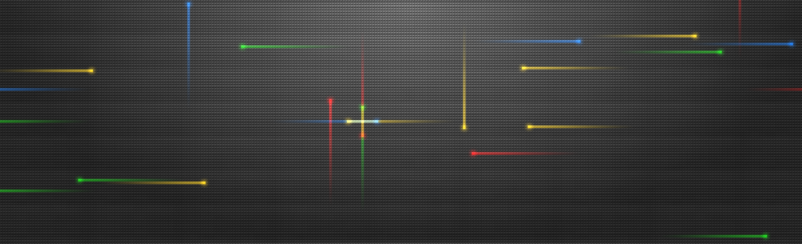

# Nexus Classic for KDE Plasma

The old Android 2.1–2.2 Nexus live wallpaper, recreated for KDE Plasma as an add-on for [Shader Wallpaper](https://github.com/y4my4my4m/kde-shader-wallpaper).



[Watch the animated preview with click bursts](docs/preview.mp4).

It uses the original AOSP pyramid, trail and glow textures. The movement and click behaviour follow the [Android 2.2 implementation](https://android.googlesource.com/platform/packages/wallpapers/Basic/+/android-2.2_r1/res/raw/nexus.rs):

- A small 14-pixel grid with red, green, blue and yellow light trails.
- Twenty ambient trails, with random directions, speeds and restart delays.
- A left-click sends four differently coloured trails out from the nearest grid cell, at 1.5 times the normal speed.
- Up to forty click trails can coexist. Holding, dragging and right-clicking do not keep spawning trails.
- One shared canvas across monitors, including monitors with different scaling.

The original Android launcher also sent icon-drop commands. This version maps the tap effect to desktop clicks; it does not react to icon drops.

## Requirements

- KDE Plasma on Linux.
- **Shader Wallpaper 4.2.4**, installed for your user with its native engine built. The integration currently targets this version.
- CMake 3.22+, a C++20 compiler, Python 3, and Qt 6.6+ development files for Core, Gui, Qml and Quick.

On openSUSE Tumbleweed, the build dependencies are:

```sh
sudo zypper install cmake ninja gcc-c++ python3 qt6-base-devel qt6-declarative-devel
```

On Ubuntu 26.04:

```sh
sudo apt install cmake ninja-build g++ python3 qt6-base-dev qt6-declarative-dev
```

## Install

```sh
git clone https://github.com/xefensor/nexus-classic-plasma.git
cd nexus-classic-plasma
python3 scripts/install.py --dry-run
python3 scripts/install.py
```

The installer builds the input helper, installs the shader under your user data directory, and adds two small hooks to your user-installed Shader Wallpaper files. It keeps a backup of the previous shader and host files. It does not restart Plasma or change your selected wallpaper.

Log out and back in once to load the hooks. Then open the wallpaper settings, browse **Retro**, and choose **Nexus Classic (Android 2.1–2.2)**. Mouse input is enabled when choosing the shader.

For a continuous wallpaper, choose it on both monitors and enable **Advanced → Experimental → Span all screens** on each one. The animation and click bursts share the same state across those monitors.

The installer respects `XDG_DATA_HOME`, `XDG_CACHE_HOME` and `XDG_STATE_HOME`. Use `--plugin-root` if your user-installed Shader Wallpaper is in another location.

## Uninstall

```sh
python3 scripts/install.py --uninstall
```

This restores the previous shader and host files, then keeps the backup in your state directory. If you edited an installed file afterward, the installer stops so those edits can be preserved or merged. Log out and back in to unload the helper.

Backups and the local installation record live under `${XDG_STATE_HOME:-~/.local/state}/nexus-classic-plasma/`.

A Shader Wallpaper update can replace the integration hooks. Update this add-on's compatibility support before reinstalling it against a newer host version.

## Build and check

```sh
cmake -S package/NexusClassic/interaction -B build -G Ninja
cmake --build build --parallel
ctest --test-dir build --output-on-failure
python3 -m unittest discover -s tests -v
```

The C++ tests cover the original pulse rules, the forty-trail pool, shared clicks, fractional scaling, hold/drag filtering and midnight handling. The Python tests cover installation, idempotence, backups, rollback and preservation of later edits.

With Shader Wallpaper installed and `qmltestrunner` available, run the rendering and input integration tests:

```sh
QT_QPA_PLATFORM=wayland python3 scripts/test_qml.py
```

These use a temporary copy of the host plugin and an isolated set of XDG directories. They check the normal wallpaper host, switching shaders, existing renderer instances and shader hot-reload. They open test windows and save captures under `build/qml-artifacts/`.

To reproduce the video and monitor-seam checks, install PySide6, NumPy, Pillow and FFmpeg, then run:

```sh
./build/nexus_snapshot build/states
QT_QPA_PLATFORM=wayland python3 package/NexusClassic/interaction/tools/render.py --gles
```

The renderer reads Shader Wallpaper's bundled engine source. Set `NEXUS_ENGINE_SOURCE` if that source is elsewhere. Output goes to `build/preview/`.

Tested with Plasma 6.8 on Wayland and mixed monitor scaling. The rendering tests also work with Mesa software rendering. Hardware performance has not been benchmarked.

## How it works

Plasma renders a wallpaper separately on each monitor. The Qt companion keeps one set of ambient and click pulses and supplies it to each renderer through a small state texture. The shader uses the screen offsets and the shared clock to draw each monitor's portion.

The companion observes left-button events on the wallpaper window without consuming them. Existing desktop interactions remain available. Its texture bindings are removed when switching to another shader.

## Credits and licence

The original Nexus wallpaper and textures are by the Android Open Source Project. This port uses Android 2.2's palette and blending; Android 2.1 used the same movement and tap rules with slightly different colour values.

The shader, companion, tools and original assets are under **Apache-2.0**; see [LICENSE](LICENSE), [NOTICE](NOTICE) and [AOSP_NOTICE](AOSP_NOTICE). The integration hooks for the GPL host are under **GPL-3.0-or-later**; see [integration/LICENSE](integration/LICENSE).

Shader Wallpaper is a separate project by [y4my4my4m](https://github.com/y4my4my4m/kde-shader-wallpaper).
